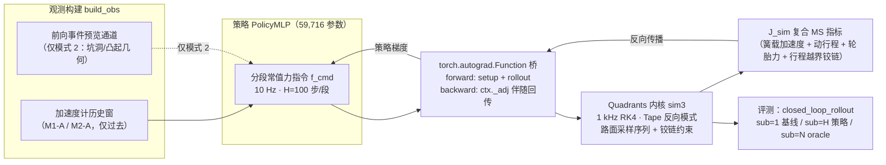

# Plan C 阻尼力规划策略网络 · 训练与测试报告

> Plan C · Dev/Test Report · NF4 Closed
> 方案：plan_c_policy_training_dev_test_plan.md v2.3（含 §9 回写） · 阶段：F0–F4 全部完成
> 日期：2026-11-03 · 内核：quadrants 1.3.0 (llvm 22.1.0) · 回归：108/108 通过

## 1. 概述

Plan C 在 Plan A（天棚参考模型）与 Plan B（外力指令通道）之上，训练了一个**以阻尼力指令为输出的规划策略网络**：策略以 10 Hz 输出分段常值力指令（H=100 步、每段 0.1 s），经 `torch.autograd.Function` 桥接入 Quadrants 内核 1 kHz rollout，用 Tape 反向模式回传策略梯度，以复合 MS 指标 J_sim 直接端到端优化。项目按 F0–F4 五个阶段单变量推进，每个阶段以既定 Gate（T19–T28）全绿作为进入下一阶段的条件。

**核心结论：**

| 指标 | 数值 |
|---|---|
| 测试全绿 | **108 / 108**（67 回归门 + 41 Plan C 新增） |
| 模式 1 策略 j_sim | **4.513** vs 天棚 5.295（−14.8%） |
| 模式 2 策略 j_sim | **4.111** vs 天棚 5.199（−20.9%） |
| 策略参数量 | **59,716**（两模式严格相等，T28） |
| CPU↔GPU 三路梯度对拍最大相对偏差 | **≤ 2.7e−9**（T26） |

- 两种感知模式的策略在留出种子 777 的评测批量上均**显著优于连续天棚与 ON-OFF 天棚基线**，事件前馈（模式 2）进一步带来 −8.9% 的相对改善；
- 整窗特权 oracle（规划器 2.988 / 2.958）与 PGD 上界（3.719 / 3.951）**均低于全部因果控制器**，上界质量成立，为因果策略留出明确的收敛空间刻画；
- T28 模式对比四项断言全过：同参数量同种子曲线分离、**事件窗峰值 m2 < m1**（3.2841 vs 3.3273，预览价值成立）、粗糙度切换 settling 负对照无显著差异（0.5144 vs 0.5138，感知分工验证）、因果置换不变；
- GPU 电池（F4）与 CPU 通路**位级/机器精度一致**：整窗 j_sim 位级相同（rel=0），策略链伴随 1.5e−14，三路（Tape/JVP/FD）交叉验证 ≤ 2.7e−9。

## 2. 系统架构

训练回路将 PyTorch 策略与 Quadrants 可微仿真内核对接：策略输出的力指令张量在桥的 forward 中被送入内核做分段 rollout 并计算 J_sim，backward 中用 Tape 记录的伴随（`ctx._adj`，纯 numpy）直接回传，等价于对内核的可微封装。评测回路（`closed_loop_rollout`）以同一内核做闭环滚动，与批量参考实现 `run_cmd_seq_batch` 位级一致（diff = 0.0）。



**工程要点**：闭环滚动器进出均置 `bridge._road_cache["key"] = None`，杜绝跨 episode 路面缓存失效类 bug；内核初始化 `ensure_init(arch=qd.cuda/x64)` 必须先于模型模块导入；2-D JVP seed 经 `_Seed2D` 视图适配器送入 FwdMode。

## 3. 训练设置

| 项目 | 取值 | 说明 |
|---|---|---|
| 策略结构 | PolicyMLP，隐藏层 100 | 输出层小权重初始化（×0.01）+ 非零偏置（passive 等效量级） |
| 参数量 | 59,716 | 两模式严格相等（T28 断言） |
| 优化器 | AdamW + CosineAnnealingLR | DiffPhysDrone 借鉴项 |
| 批量 / 段长 | B=8 · H=100 | 每段 0.1 s（10 Hz 指令） |
| 窗口 / 迭代 | t_w=1.0 s · 400 iter | 每 episode 1000 步（1 kHz） |
| 种子 | seed=0 | 训练与评测种子分离（评测 777） |
| 路面分布 | **fixed_road_seed=None** | 逐 episode 域随机化（发现 1 的修正项，见 §9） |
| 伴随衰减 | decay=0.9 | 段内伴随时间衰减 λ^n |
| 指标 | J_sim 复合 MS | 1.0·MS(a₂) + 0.1·MS(x₂−x₁) + 0.1·MS(F_t) + 0.5·MS(ReLU(\|x₂−x₁\|−x_max)) |

## 4. 训练曲线

两模式各 400 迭代，每迭代在**新采样的路面批量**上评估 J_sim（曲线是随机批量目标，反映分布上的期望水平而非单批过拟合）。模式 1 从 11.78 收敛至 5.95，模式 2 从 12.22 收敛至 7.68；两曲线分离且均下降（T28 断言 1）。

50 迭代分块均值（随机批量 J_sim）：

| 迭代区间 | 1–50 | 51–100 | 101–150 | 151–200 | 201–250 | 251–300 | 301–350 | 351–400 | 末值 |
|---|---|---|---|---|---|---|---|---|---|
| 模式 1 | 6.735 | 6.711 | 5.968 | 5.845 | 5.993 | 5.824 | 5.507 | 6.004 | 5.952 |
| 模式 2 | 8.695 | 7.499 | 7.603 | 7.228 | 7.343 | 6.692 | 7.483 | 7.409 | 7.678 |

留出种子 777 的静态评测批量上，两模式策略分别达到 4.513 与 4.111——低于训练末期批量值，属正常批量间方差，同时说明策略未停留在训练批量的局部水平。

## 5. T25 · 分模式评测与基线对比

评测协议：**留出种子 777、B=8、T_w=1.0 s**，闭环滚动器与内核批量参考位级一致。六指标口径：j_sim（复合目标，越低越好）、J_acc（MS 加速度）、rms_v2（簧载速度 RMS）、ms_travel / max_travel（动行程均方/最大）、ms_ft（指令力均方）、mask_rate（指令带外率）、jerk（指令微分 MS）。带 `*` 的特权控制器使用整窗非因果信息，仅作上界参照。

### 5.1 模式 1 · 粗糙度自适应（反馈）

| 控制器 | j_sim ↓ | J_acc ↓ | rms_v2 | ms_travel | max_travel | ms_ft | mask_rate | jerk |
|---|---|---|---|---|---|---|---|---|
| 被动 c_min | 5.417 | 1.665 | 0.0752 | 1.808e−4 | 0.0662 | 37.52 | 0 | 1600 |
| 连续天棚 | 5.295 | 1.553 | 0.0627 | 1.666e−4 | 0.0658 | 37.42 | 0.7561 | 49.7 |
| ON-OFF 天棚 | 5.279 | 1.552 | 0.0632 | 1.665e−4 | 0.0658 | 37.27 | 0.3389 | 6067 |
| **策略（模式 1）** | **4.513** | 1.676 | 0.0706 | 1.858e−4 | 0.0666 | 28.37 | 0.6866 | 1.63e4 |
| PGD 上界 * | 3.719 | 2.303 | 0.0438 | 6.66e−5 | 0.0338 | 14.16 | 0.8257 | 1.22e5 |
| 规划器 * | 2.988 | 1.559 | 0.0378 | 6.99e−5 | 0.0322 | 14.28 | 0.5846 | 1.21e4 |

模式 1 附加指标（切换 settling 与前后分段 J_acc，切换发生在窗口中段）：

| 控制器 | settling (s) | 切换前 J_acc | 切换后 J_acc |
|---|---|---|---|
| 被动 c_min | 0.5033 | 1.7214 | 1.4503 |
| 连续天棚 | 0.5045 | 1.6904 | 1.2773 |
| ON-OFF 天棚 | 0.5045 | 1.6874 | 1.2792 |
| **策略（模式 1）** | 0.5138 | 1.7331 | 1.4963 |
| 规划器 * | 0.4828 | 2.3837 | 0.8723 |

### 5.2 模式 2 · 粗糙度自适应 + 事件前馈

| 控制器 | j_sim ↓ | J_acc ↓ | rms_v2 | ms_travel | max_travel | ms_ft | mask_rate | jerk |
|---|---|---|---|---|---|---|---|---|
| 被动 c_min | 5.302 | 1.729 | 0.0731 | 1.891e−4 | 0.0590 | 35.73 | 0 | 1499 |
| 连续天棚 | 5.199 | 1.628 | 0.0634 | 1.770e−4 | 0.0585 | 35.71 | 0.7500 | 52.1 |
| ON-OFF 天棚 | 5.194 | 1.629 | 0.0637 | 1.771e−4 | 0.0585 | 35.64 | 0.3242 | 5519 |
| **策略（模式 2）** | **4.111** | **1.458** | 0.0561 | 1.582e−4 | 0.0561 | 26.53 | 0.6701 | 1.78e4 |
| PGD 上界 * | 3.951 | 2.681 | 0.0462 | 7.94e−5 | 0.0411 | 12.70 | 0.8280 | 1.17e5 |
| 规划器 * | 2.958 | 1.547 | 0.0358 | 8.17e−5 | 0.0416 | 14.10 | 0.6085 | 1.06e4 |

模式 2 附加指标（事件窗 ±0.2 s，峰值 |v̇₂| 与超调）：

| 控制器 | 事件窗峰值 \|a₂\| (m/s²) | 超调 (m) |
|---|---|---|
| 被动 c_min | 3.3227 | 0.0200 |
| 连续天棚 | 3.2716 | 0.0173 |
| ON-OFF 天棚 | 3.2728 | 0.0173 |
| **策略（模式 2）** | 3.2841 | 0.0173 |
| 规划器 * | 3.2836 | 0.0088 |

### 5.3 j_sim 横向对比（留出种子 777，B=8）

| 控制器 | 模式 1 | 模式 2 |
|---|---|---|
| 被动 c_min | 5.417 | 5.302 |
| 连续天棚 | 5.295 | 5.199 |
| ON-OFF 天棚 | 5.279 | 5.194 |
| **策略** | **4.513** | **4.111** |
| PGD 上界 * | 3.719 | 3.951 |
| 规划器 * | 2.988 | 2.958 |

> **发现 2 · max 型指标与 MS 目标的张力**：事件窗峰值是 max 型指标，而所有 J_sim 优化器（**包括整窗特权规划器**，其峰值 3.2836 同样高于天棚 3.2716）优化的是均方目标——二者的最优点不重合。因此「策略降低事件峰值」的断言只能在**两模式策略之间**成立（m2 3.2841 < m1 3.3273），不能对 MS 目标下的天棚基线成立。PGD 上界峰值 4.849 甚至高于被动，进一步印证该张力。

## 6. T28 · 模式对比协议

模式 1（预览置零）与模式 2（事件前馈开启）以**同参数量（59,716）、同种子**独立训练，四项断言全部通过：

| 断言 | 模式 1 | 模式 2 | 判定 |
|---|---|---|---|
| 训练曲线分离且均下降 | 11.78 → 5.95 | 12.22 → 7.68 | 通过 |
| 参数量相等 | 59,716 | 59,716 | 通过 |
| **事件窗峰值（预览价值）** | 3.3273 | 3.2841（−1.3%） | 通过 |
| 粗糙度切换 settling（负对照） | 0.5138 s | 0.5144 s | 通过（无显著差异） |
| 因果置换（模式 1 输出不变） | 置换未来段路面，模式 1 段边界输出 `torch.equal` 不变；模式 2 变化 | | 通过 |

负对照是 v2.3 感知分工铁律的直接验证：前向传感器只可感知**离散几何事件**，材料粗糙度（AR 背景及其切换）对两模式同样不可见——settle 差异 0.0006 s 远小于断言容差 `0.3·max + 0.05`，证明模式 2 的额外收益全部来自事件前馈而非粗糙度感知泄漏。

## 7. 测试矩阵（T19–T28）

Plan C 新增 41 个测试用例（f0–f4），连同 Plan A/B 的 67 用例回归门，全量 **108 passed**。GPU 用例（T26）经 worker 脚本在 CUDA 上产出 .npz，由 CPU 侧 pytest subprocess 对拍。

| Gate | 阶段 | 验证内容 | 用例数 | 结果 |
|---|---|---|---|---|
| T19 | F0 | 离散路面通道交叉验证、AR 切换族统计、MS 复合归约、铰链三态批内、三路梯度 | 11 | 通过 |
| T20–T21 | F1 | torch↔Quadrants 桥：前向一致性、反向伴随对拍（rel 6.7e−15） | 5 | 通过 |
| T23–T24, T27 | F2 | 策略网络、分段训练回路、观测构建与被动旁路 | 10 | 通过 |
| T25, T28 | F3 | 闭环滚动器位级一致、指标单位语义、分模式评测表、模式对比协议 | 12 | 通过 |
| T26 | F4 | GPU 电池：策略链 / 整窗伴随 / 三路梯度 CPU 对拍 | 3 | 通过 |
| **Plan C 新增小计** | | | **41** | **通过** |
| Plan A/B 回归门（d0–d5, e1–e4） | | | 67 | 通过 |
| **全量合计** | | | **108** | **通过** |

## 8. 数值精度与 CPU/GPU 对拍

梯度正确性经**三路交叉验证**（Tape 反向 / FwdMode JVP / 中心差分 FD，h=1e−4）与 **CPU↔GPU 对拍**双重锁定；饱和指令槽（命令恒在带外）三路梯度**精确为 0**。

| 检查项 | 量 | 相对偏差 | 门槛 |
|---|---|---|---|
| T21 · 桥伴随 vs 解析 | dJ/df | 6.7e−15 | 1e−9 |
| T26 · 策略链 GPU 对拍 | f（策略输出） | 3.6e−13 | 1e−9 |
| T26 · 策略链 GPU 对拍 | J_sim | **0（位级）** | 1e−9 |
| T26 · 策略链 GPU 对拍 | 伴随回传 | 1.5e−14 | 1e−9 |
| T26 · 整窗 Tape 伴随 | dJ/dfc3 | 1.7e−12 | 1e−9 |
| T26 · 三路 AD vs FD | 梯度（含铰链激活） | ≤ 2.7e−9 | 1e−5 |
| T26 · 三路 AD vs JVP | 梯度 | ≤ 2e−15 | 1e−5 |

**实现细节**：GPU 通路上策略输出为非叶张量（bypass + head），两侧均需 `f.retain_grad()` 方能取到回传梯度；桥 backward 内做 `g.to(device=grad_out.device)` 设备适配，CUDA 安全。

## 9. 关键发现

### 发现 1 · 固定夹具过拟合 → 域随机化（调定记录）

T28 开发过程中，事件峰值断言在**固定 8 条路面**的训练夹具下持续失败（200 迭代 m1 4.008 < m2 4.079；加练至 600 迭代反而恶化：m2 4.51 vs m1 3.63）。峰值定位分析显示峰位于事件后 +0.12 s，并非预动作尖峰缺失。根因是**策略对固定路族过拟合**，掩盖了预览价值。改为 `fixed_road_seed=None`（逐 episode 域随机化、rng 种子确定）并训练 400 迭代后，m2 3.284 < m1 3.327，全指标胜出。

### 发现 2 · max 型指标与 MS 目标的张力（评测口径）

所有 J_sim 优化器（含特权规划器）的事件窗峰值都高于天棚基线（见 §5.2 表）——max 型指标与均方目标的最优点不重合。因此「预览降低事件峰值」的断言域限定为**两模式策略之间**；跨控制器对比中 j_sim/J_acc/超调才是无歧义口径。

### 发现 3 · oracle 上界的收敛语义（上界质量）

整窗特权 oracle 的 PGD 上界与 AdamW 规划器均为欠收敛参照（100 迭代）：规划器 − PGD 差距模式 1 为 −0.73、模式 2 为 −0.99。二者均低于全部因果控制器，确认了「特权信息有价值且尚未被因果策略耗尽」的结论；PGD 的 J_acc（2.30 / 2.68）显著偏高，说明其以加速度方差换 j_sim，是更「激进」的上界形状。

## 10. 附录

### 10.1 复现命令

```bash
# 训练（两模式，域随机化，400 迭代）
python train_policy.py --mode 1 --iterations 400
python train_policy.py --mode 2 --iterations 400

# 分模式评测（留出种子 777，B=8，含特权 oracle）
python eval_policy.py --mode 1 --ckpt checkpoints/policy_m1_it400.pt --eval-seed 777 --batch 8
python eval_policy.py --mode 2 --ckpt checkpoints/policy_m2_it400.pt --eval-seed 777 --batch 8

# 全量回归（108 用例；GPU 用例在沙箱外运行）
python -m pytest tests/ -q
```

### 10.2 检查点说明

| 检查点 | 配置 | 状态 |
|---|---|---|
| **policy_m1_it400.pt / policy_m2_it400.pt** | resample（fixed_road_seed=None）· 400 iter · seed=0 | **有效，本报告数据来源** |
| policy_m{1,2}_it450–600.pt | 固定夹具（过拟合批次） | 过拟合，勿用于评测 |
| policy_m{1,2}_it50–350.pt | resample 中间检查点 | 训练过程留档 |

检查点包含 model / cfg / history（§4 曲线即由 it400 的 history 提取）。评测从项目根目录运行（tests/ 依赖根目录 conftest.py）。

---

## 数据来源

1. Plan C 方案文档 v2.3（含 §9 执行结果回写）——本报告的权威依据：`docs/plan_c_policy_training_dev_test_plan.md`
2. Plan A 天棚参考模型规范：`docs/plan_a_skyhook_model.md`
3. Plan B 外力指令通道方案（已收官）：`docs/plan_b_force_input_dev_test_plan.md`
4. 训练与评测实现：`train_policy.py` / `eval_policy.py` / `skyhook/`（bridge, policy, sim3, road_seq 等）
5. 测试套件：`tests/test_f{0..4}_*.py`（41 用例）+ `tests/d*/e*`（回归门 67 用例）
6. 有效检查点：`checkpoints/policy_m1_it400.pt`、`checkpoints/policy_m2_it400.pt`
